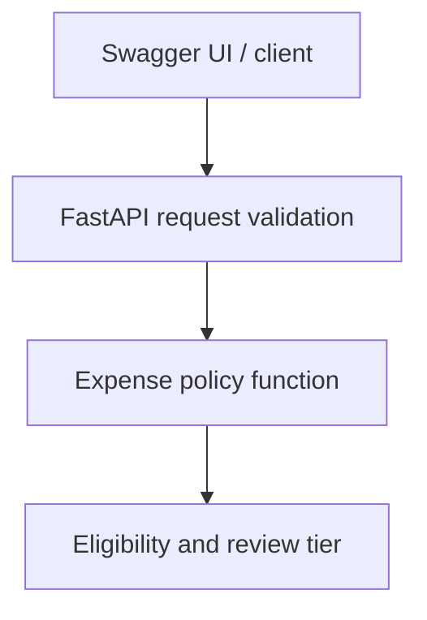

# ExpenseFlow — phase 1

A portfolio application for employee expense claims, approval workflows, and audit history.
**Current status:** local policy-preview API and tests only. No authentication,
database, claim submission, actual approval, or cloud deployment exists yet.
Use fictional data. Do not expose this development server publicly.

## Business rules (fictional company, not tax/legal advice)

| Category | Per-claim maximum |
| --- | ---: |
| meal | INR 1,000 |
| travel | INR 5,000 |
| equipment | INR 20,000 |

All amounts use integer paise: INR 750 = 75000. Amount must be positive and
no more than INR 100,000 at the API validation layer. Category policy limits
are lower. Exactly at a category maximum is eligible. Eligible claims above
INR 10,000 require finance review; other eligible claims require manager review.
Eligible means within policy, not approved. Limits apply to individual claims;
there is no daily aggregation or currency conversion in phase 1.

## Windows Command Prompt

Install Python 3.12 and Git. Open a terminal in this folder, beside README.md:

```bat
py -3.12 -m venv .venv
.venv\Scripts\activate.bat
python -m pip install -r requirements-dev.txt
python -m pytest -q
python -m uvicorn app.main:app --reload --port 8000
```

Open http://127.0.0.1:8000/docs. Under POST /api/v1/policy/check, select
Try it out and submit:

```json
{"category": "meal", "amount_paise": 75000, "currency": "INR"}
```

Expect HTTP 200, eligible true, required_approver manager. A meal of 150000
paise returns HTTP 200, eligible false, required_approver null. It is a valid
request with a negative business decision. An amount of -1 returns HTTP 422:
the request itself is invalid. Equipment of 1500000 paise requires finance.

On macOS/Linux use python3.12 -m venv .venv and source .venv/bin/activate.
If port 8000 is occupied, use --port 8001 and change the browser URL.
Stop with Ctrl+C. No cloud resources are created in this phase.

## Folder responsibilities

- app/main.py: HTTP endpoints and API composition.
- app/schemas.py: validates requests and defines response contracts.
- app/policy.py: deterministic business decision without HTTP/database code.
- tests/test_policy.py: API tests for limits, review thresholds, invalid inputs.
- requirements.txt: pinned runtime dependencies, including transitive packages.
- requirements-dev.txt: runtime plus pinned test dependencies.
- .github/workflows/ci.yml: installs dependencies and runs tests on main pushes/PRs.

The workflow currently tests only. Container builds and deployment are added
in later phases, after database and authentication are implemented. Action
major-version tags improve readability here; pin reviewed full commit SHAs
and automate updates before the deployment pipeline is finalized.

## GitHub (optional in this checkpoint)

Create an empty GitHub repository called expenseflow, without auto-generated
files. Then, replacing YOUR_USERNAME:

```bat
git init
git add .
git commit -m "Add expense policy API and boundary tests"
git branch -M main
git remote add origin https://github.com/YOUR_USERNAME/expenseflow.git
git push -u origin main
```

Use GitHub's supported sign-in flow; never paste access tokens into source.
See the Actions tab for ExpenseFlow CI. The workflow has no GCP credentials.

## Architecture implemented now



## Next phases (not implemented)

1. MySQL in Docker, SQLAlchemy, Alembic; claims, atomic state transitions and audit rows.
2. Managed identity, token verification, employee/manager/finance roles, owner checks,
   no self-approval, minimal browser UI, secure receipt uploads.
3. Non-root container, GitHub test/build pipeline, Artifact Registry, restricted GitHub
   OIDC/Workload Identity Federation, Cloud SQL, Secret Manager and Cloud Run.
4. Structured redacted logs/request IDs, metrics and alerts, retries/timeouts,
   concurrency tests, connection limits and revision rollback.
5. Verification, demo, architecture, evidence-based resume bullets and cleanup.

Planned cloud architecture: browser with managed sign-in -> Cloud Run FastAPI ->
Cloud SQL MySQL, Cloud Storage receipts, Secret Manager; Cloud Logging/Monitoring.
Database credentials are separate from user sign-in credentials. CI deploy identity
is separate from the runtime service account. Browser-provided role fields never
grant privileges.

## Interview practice for this phase

Why integer paise? Binary floating point can introduce rounding errors; integer
minor units work well for a single currency. A real multi-currency system must
track currency-specific minor units and rounding rules.

Why separate policy from endpoints? Rules can be tested and reused independently
of HTTP. This adds a small amount of structure but makes later changes clearer.

Why test exact boundaries? Off-by-one mistakes can route claims incorrectly.

Why 200 for policy failure and 422 for negative amounts? A well-formed request can
receive a negative policy decision. Negative money violates the API contract.

Can a caller become finance by editing JSON? No roles are implemented yet;
required_approver is a recommendation, not authorization. Later the API will
verify identity and enforce stored roles and ownership before changing a claim.

## Troubleshooting

| Symptom | Check |
| --- | --- |
| py -3.12 not found | Install Python 3.12 and restart the terminal; use py -0p to inspect installed versions. |
| No module named app | Run from the folder containing app/, not inside app/. |
| No module named fastapi | Activate .venv and install requirements using python -m pip. |
| Connection refused | Keep uvicorn running; check host/port and its terminal errors. |
| HTTP 422 | Check category, positive integer paise, INR currency and unknown fields. |

## Current limitations and truthful project description

Implemented: input validation, explicit business rules, versioned policy output,
boundary tests, local API documentation, CI test configuration and dependency pins.
Unimplemented: persistence, authentication/authorization, audit storage, cloud
secrets, deployment, observability, scaling, and rollback. Never claim these as done.

An accurate current description: "Built a FastAPI expense-policy preview API with
integer-based monetary validation and automated tests for policy boundaries."
Only claim GitHub CI after a successful run in your own repository.
